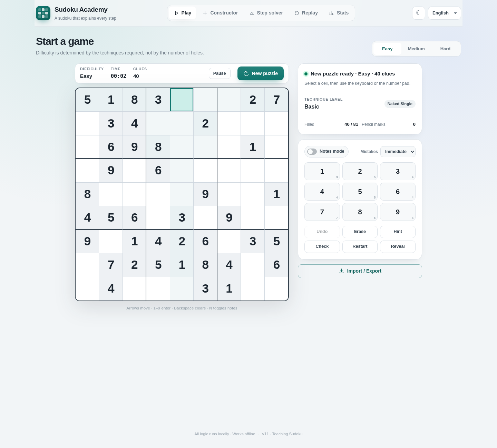

# Sudoku Academy

An offline teaching Sudoku app with unique-solution puzzles, a constructor,
19 human-style solving techniques, photo import, replay, statistics and six languages.
One shared source tree supports Web, Windows, Android, iOS and WeChat.

[中文](../README.md) · [Build guide](BUILD.md) · [Detailed feature guide](USER_GUIDE.md)



## Development

Use Node.js 22.12+ and npm. Run from the repository root:

```sh
npm ci
npm test
npm run serve
```

Open http://127.0.0.1:8080/ . Run `npm start` for Electron development.

## Distribution

```sh
npm run dist:assets
npm run dist:win
npm run dist:android
npm run dist:verify
```

Outputs go to the sibling `../dist/` directory, outside Git. Windows packaging
requires Windows; Android requires JDK 17 and Android SDK 35. iOS output is an
Xcode project; compilation requires macOS/Xcode. The WeChat output can be imported
into WeChat Developer Tools. Generated copies and dependency caches are ignored.

Shared application code is in `src/`; HTML/CSS and vendored OCR assets in `web/`;
platform shells in `platforms/`; build configuration in `config/`.

See [third-party notices](THIRD_PARTY_NOTICES.md) and the [MIT license](../LICENSE).
