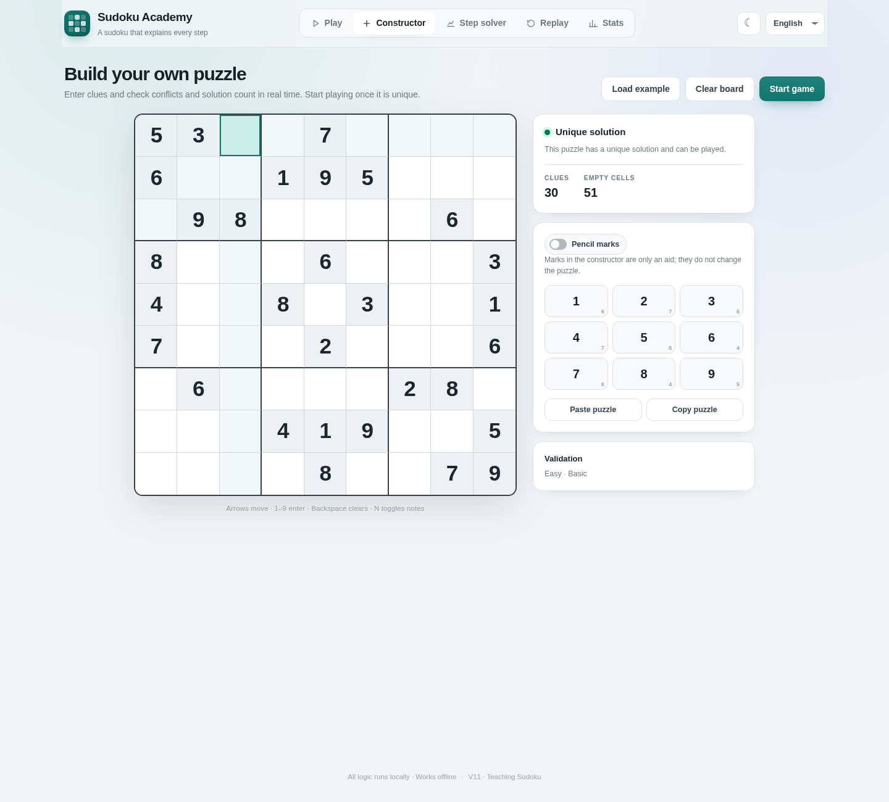
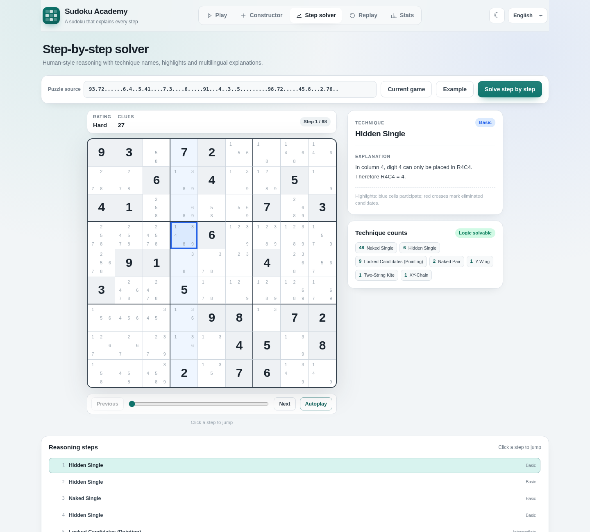
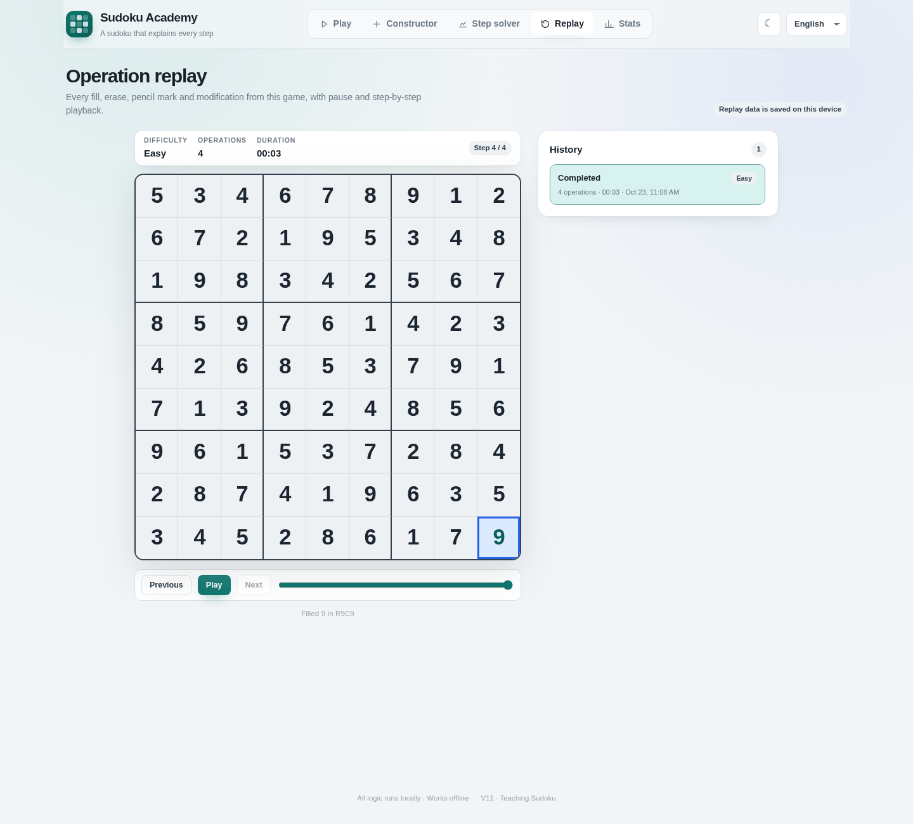
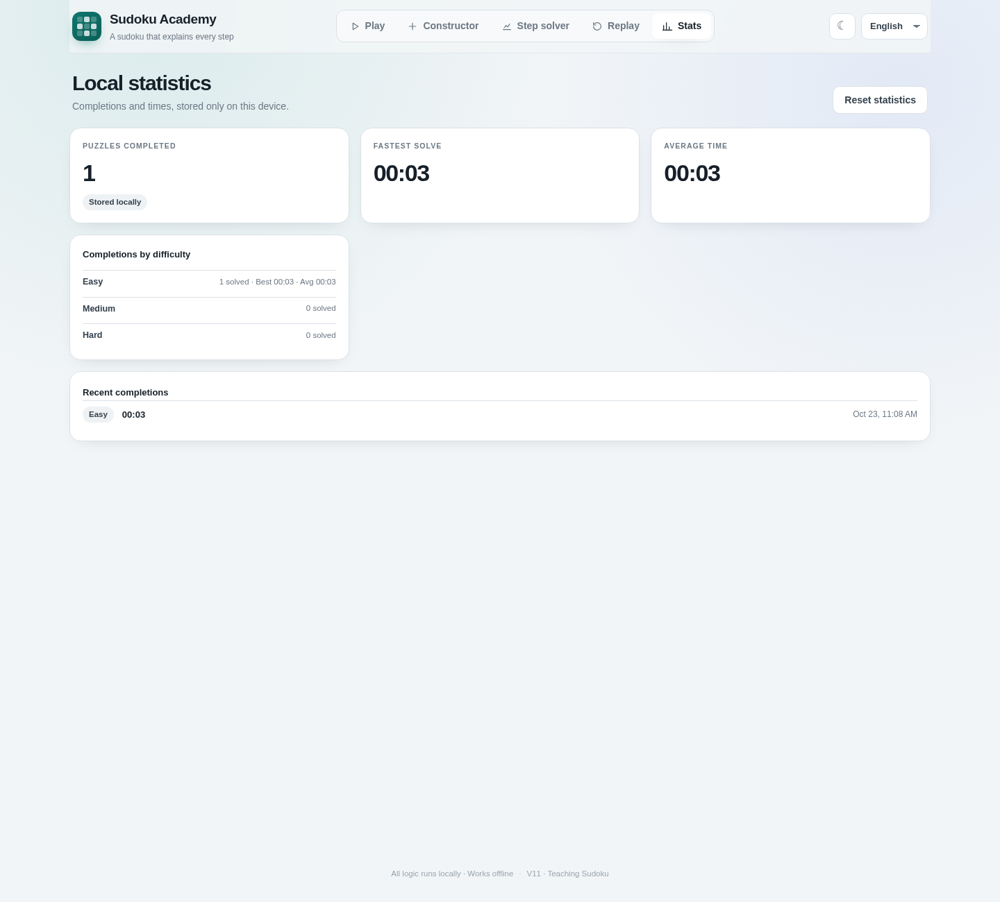
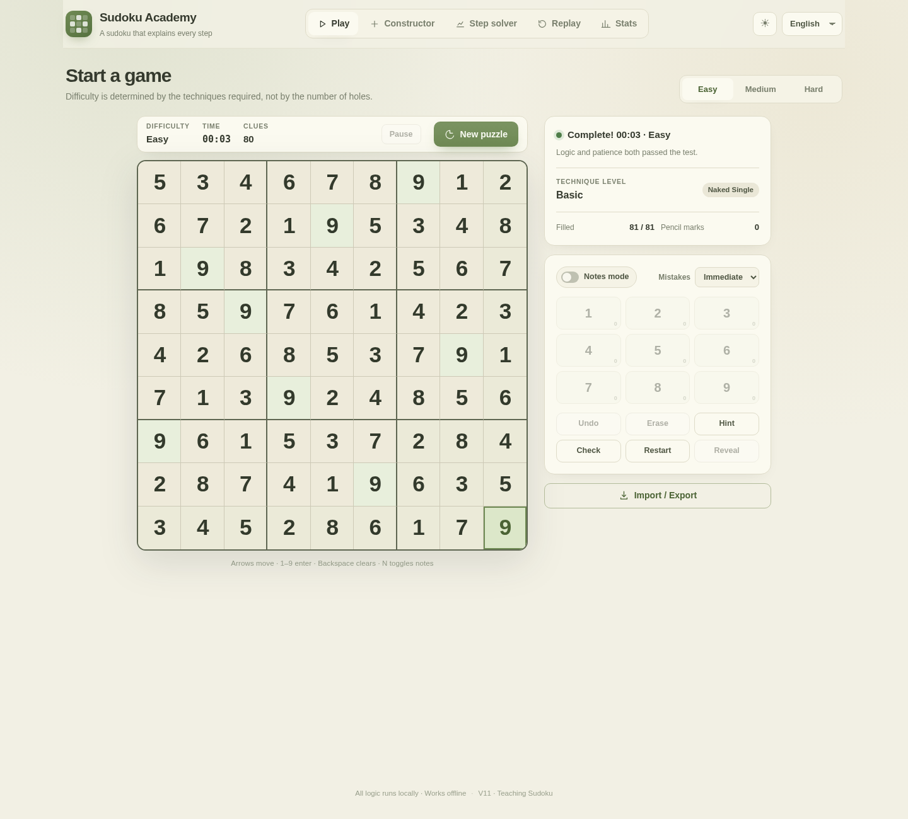
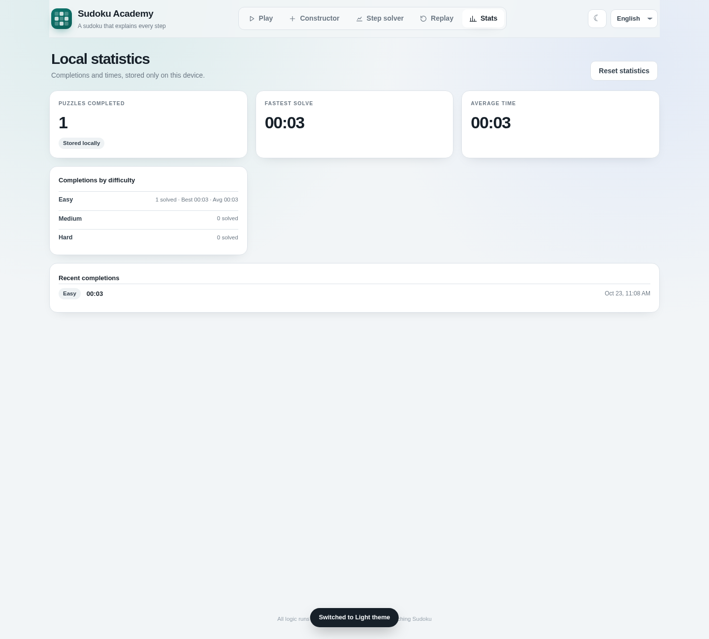
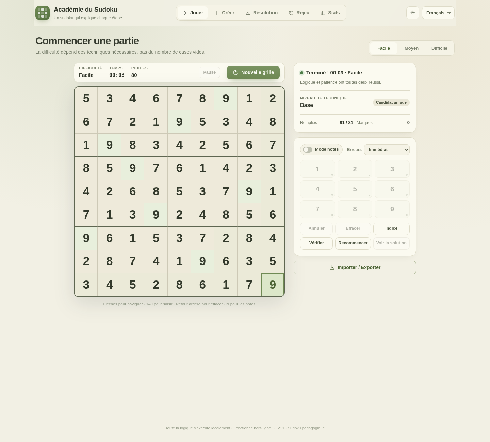

# 使用指南

数独学院支持游玩、题目构造、逐步求解、操作回放与本地统计。
本页介绍使用方式；源码目录、环境要求和打包命令见 [构建指南](BUILD.md)。

## 启动

| 交付目录（相对仓库根目录） | 使用方法 |
| --- | --- |
| `../dist/web/` | 双击 `index.html`，或在该目录启动静态服务器 |
| `../dist/windows/` | 运行 Setup 安装版或 Portable 便携版 |
| `../dist/android/` | 在 Android 7.0+ 设备安装调试 APK |
| `../dist/ios/` | 在 macOS/Xcode 打开 `App/App.xcodeproj`，选择 App Scheme 和模拟器 |
| `../dist/wechat/` | 使用微信开发者工具导入该目录；真机预览需自己的 AppID |

从源码启动时，在仓库根目录执行 `npm ci`，然后运行 `npm run serve`。
打开 http://127.0.0.1:8080/ 。生成资源后也可直接打开 `web/index.html`。

## 游玩

选择简单、中等或困难，生成唯一解题目。点击格子后用键盘 1–9 或屏幕数字键输入，
使用擦除、撤销、暂停和重新开始管理进度。候选模式用于记录可能的数字，网页可用 `N` 切换。
错误显示可以选择即时提示、点击检查时提示或关闭。

提示功能给出当前局面可以使用的一步逻辑，并允许应用；显示答案会结束本局，
不会把这次操作计入成功完成统计。

难度按人类求解器实际使用的最高技巧等级划分，已知数字多少仅用于生成搜索：

| 难度 | 最高技巧等级 | 例子 |
| --- | --- | --- |
| 简单 | Tier 1 | 唯一余数、隐性唯一 |
| 中等 | Tier 2–3 | 数对、区块排除、三数组、X-Wing、剑鱼、Y-Wing |
| 困难 | Tier 4 | 水母、唯一矩形、着色、W-Wing、XY-Chain |

## 导入和导出

文本题面使用 81 位数字，空格写作 `0` 或 `.`；也可以导出题目、当前进度和答案。
导入前会检查格式、行列宫冲突以及解的数量。

拍照识别入口提供相机和相册选项。尽量让棋盘完整入镜、光照均匀，避免反光和严重模糊。
程序会尝试定位棋盘、矫正旋转或透视，并校验识别出的题面；识别后仍应核对数字。
没有可用摄像头或权限被拒绝时，可改用图片文件。
iOS 模拟器使用相册图片。各端具体能力见 [OCR 说明](OCR.md)。

识别在本机完成：Web、Windows、Android、iOS 使用内嵌 Tesseract WASM；
微信使用离线模板分类器。运行时不依赖云端 OCR。

## 构造题目

在构造器中输入已知数字和候选标记。界面会区分冲突、无解、多解和唯一解；
只有唯一解题目可以转入游戏，并继承已有候选标记。可使用示例、清空和文本导入辅助构造。

## 逐步求解

输入题面后启动求解。每一步显示技巧名称、等级、涉及的格子和候选，以及当前语言的解释。
使用上一步、下一步、滑杆、步骤列表或自动播放查看推理过程。

求解器实现 19 种技巧，详见 [技巧说明](TECHNIQUES.md)。当已有技巧无法继续推进时，
会报告停滞。唯一矩形依赖题目唯一解，多解题应关闭这一假设。

## 回放和统计

操作回放保存初始局面及填数、擦除、候选、撤销、提示、显示答案等动作后的快照。
可播放、暂停、逐步查看或用滑杆跳转。

统计记录完成题数、各难度完成数、最快和平均用时，并支持重置。
Web、桌面和移动 WebView 使用各自的本地存储，微信使用微信本地存储，彼此不自动同步。
清除浏览器或应用数据会影响这些记录。

| 操作回放示例 | 本地统计示例 |
| --- | --- |
|  |  |

## 语言和主题

顶栏可切换简体中文、繁体中文、英语、日语、法语和西班牙语，界面和求解说明即时更新。
浅色、深色、护眼主题独立于语言设置，选择保存在本地。

| 护眼主题示例 | 深色统计示例 |
| --- | --- |
|  |  |

